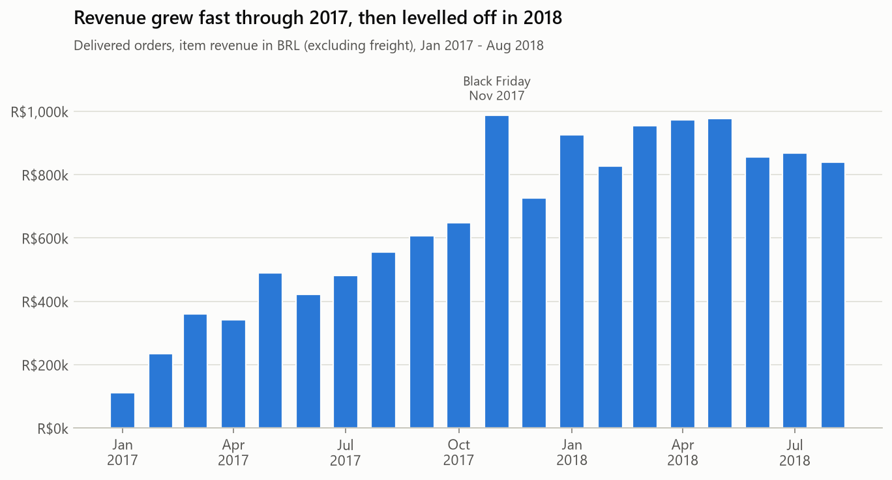
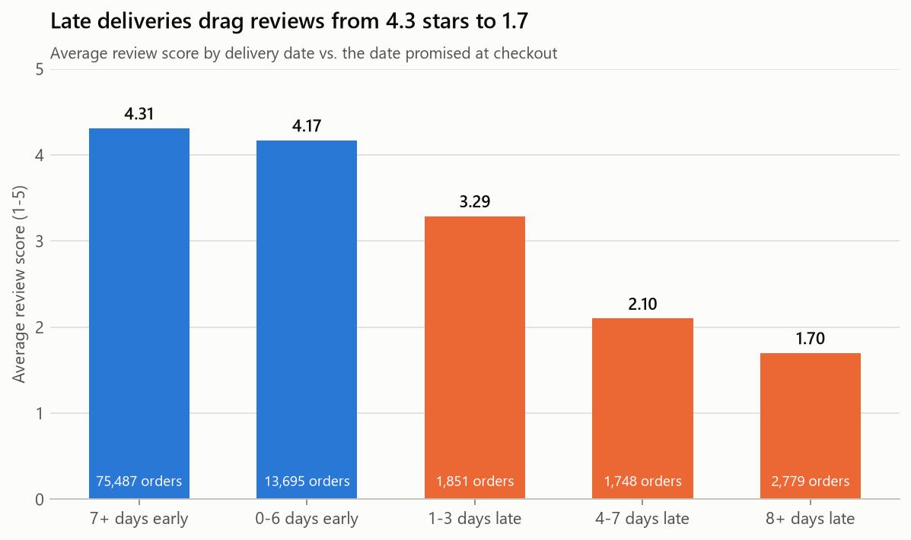
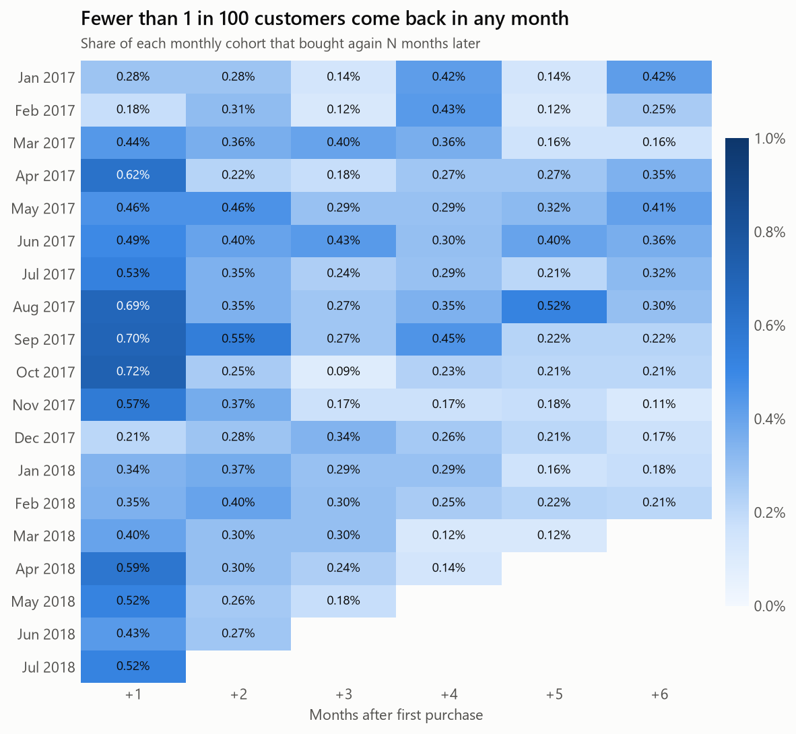
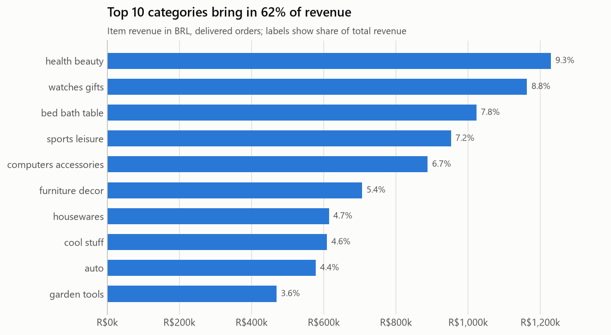
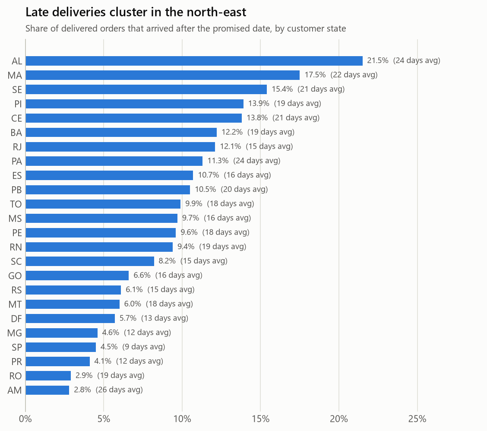
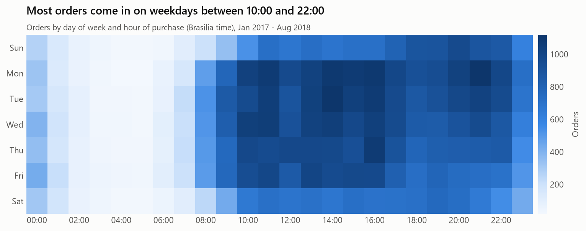

# Olist E-Commerce: SQL Business Analysis

An end-to-end SQL analysis of **96,000 delivered orders** from Olist, a Brazilian online marketplace. It answers 15 questions a commercial or operations team would ask: where revenue comes from, whether customers return, how delivery affects satisfaction, and which sellers need attention.

All analysis is in SQL ([`sql/`](sql/)), run on DuckDB. The queries use standard SQL (CTEs, window functions, `PERCENTILE_CONT`), so they port to PostgreSQL with minor type changes. Python only loads the data, runs the queries and draws the charts.

## Key findings

1. **Late delivery is the biggest driver of bad reviews.** On-time orders average **4.3 stars**. Orders 8+ days late average **1.7**, and **79%** of them get 1 or 2 stars (vs. 9% for early orders). Only 6.6% of orders are late, but they produce about a third of all 1–2 star reviews.
2. **Almost nobody comes back.** **97%** of customers ordered once. Month-one retention averages **0.5%**. Repeat customers spend 1.8× more over their lifetime, but bring in only 5.5% of revenue.
3. **Growth stalled in 2018.** Revenue for January–August 2018 was **R$7.2M, up 141%** on the same months of 2017, but monthly revenue stayed flat at R$0.8–1.0M throughout 2018. Black Friday (24 Nov 2017) brought in **7.2×** an average day's orders.
4. **Logistics are uneven by region.** In the north-east, up to **22%** of orders arrive late (Alagoas) and shipping costs up to **26%** of the item price (Maranhão). In São Paulo, 4.5% are late and shipping costs 14%.
5. **Revenue is concentrated.** São Paulo state generates **38%** of revenue. **18 of 74** categories make up 80% of revenue, led by health & beauty, watches & gifts, and bed & bath.
6. **34 of the 424 sellers** with 50+ orders average below 3.8 stars. Their orders are late almost twice as often (11.6% vs. 6.1%).

## Recommendations

- **Fix delivery promises before delivery speed.** 79% of orders arrive a week or more early, so the estimates are padded for most orders but too tight for some routes. Setting estimates by route (seller state → customer state) would cut late orders without any change to logistics.
- **Prioritise north-east logistics,** where late rates are 3–5× higher than in São Paulo. Options include regional carriers, or warehouses for the top categories.
- **Launch a second-purchase program.** With 0.5% monthly retention, even small gains matter. Start with a post-delivery email offering a discount on the next order, and measure it with an A/B test.
- **Put low-rated sellers on a performance plan** that combines rating and late-rate thresholds.

## Charts







<details>
<summary>More charts: categories, delivery by state, purchase timing</summary>







</details>

## The 15 questions

| # | Question | SQL techniques | Query | Result |
|---|---|---|---|---|
| 1 | How did revenue, orders and average order value change by month? | `LAG` window, month-over-month growth | [q01](sql/q01_monthly_revenue.sql) | [csv](reports/results/q01_monthly_revenue.csv) |
| 2 | Which categories drive revenue, and how concentrated is it? | Running `SUM() OVER`, `RANK`, Pareto | [q02](sql/q02_category_pareto.sql) | [csv](reports/results/q02_category_pareto.csv) |
| 3 | Where do customers and revenue come from? | Share of total with nested aggregate window | [q03](sql/q03_revenue_by_state.sql) | [csv](reports/results/q03_revenue_by_state.csv) |
| 4 | How many customers come back? | Two-level aggregation, segment shares | [q04](sql/q04_repeat_customers.sql) | [csv](reports/results/q04_repeat_customers.csv) |
| 5 | What share of each monthly cohort returns? | Cohort analysis, month offsets | [q05](sql/q05_cohort_retention.sql) | [csv](reports/results/q05_cohort_retention.csv) |
| 6 | How fast and reliable is delivery by state? | `PERCENTILE_CONT` median, `HAVING` | [q06](sql/q06_delivery_by_state.sql) | [csv](reports/results/q06_delivery_by_state.csv) |
| 7 | How much does lateness hurt reviews? | `CASE` bucketing, conditional averages | [q07](sql/q07_late_delivery_reviews.sql) | [csv](reports/results/q07_late_delivery_reviews.csv) |
| 8 | Which sellers perform well or badly? | Grain control to avoid double counting, `RANK` | [q08](sql/q08_seller_scorecard.sql) | [csv](reports/results/q08_seller_scorecard.csv) |
| 9 | How do customers pay? | Joins, share of total | [q09](sql/q09_payment_methods.sql) | [csv](reports/results/q09_payment_methods.csv) |
| 10 | Do bigger purchases use more installments? | `CASE` bands | [q10](sql/q10_installments_vs_value.sql) | [csv](reports/results/q10_installments_vs_value.csv) |
| 11 | When do customers shop? | `EXTRACT` day of week and hour | [q11](sql/q11_purchase_timing.sql) | [csv](reports/results/q11_purchase_timing.csv) |
| 12 | Which states pay most for shipping? | Ratio of sums vs. average of ratios | [q12](sql/q12_freight_burden.sql) | [csv](reports/results/q12_freight_burden.csv) |
| 13 | How do customers segment by RFM? | `NTILE` scoring, scalar subquery | [q13](sql/q13_rfm_segments.sql) | [csv](reports/results/q13_rfm_segments.csv) |
| 14 | Which categories grew fastest year over year? | Conditional aggregation pivot | [q14](sql/q14_category_growth.sql) | [csv](reports/results/q14_category_growth.csv) |
| 15 | What were the busiest days? | Window average vs. `LIMIT` | [q15](sql/q15_peak_days.sql) | [csv](reports/results/q15_peak_days.csv) |

## Data

- **Source:** [Brazilian E-Commerce Public Dataset by Olist](https://www.kaggle.com/datasets/olistbr/brazilian-ecommerce) (Kaggle), licensed CC BY-NC-SA 4.0. The raw data isn't included in this repo.
- **Contents:** 9 linked tables covering 99,441 orders from September 2016 to October 2018: customers, orders, order items, payments, reviews, products, sellers, geolocation and a category translation table.
- **Model:** `orders` is the hub. Items, payments and reviews link to it on `order_id`; customers on `customer_id`; products and sellers through `order_items`.

## Data quality and modeling decisions

Checked before any analysis ([`02_data_quality.sql`](sql/02_data_quality.sql), [results](reports/results/02_data_quality.csv)):

| Issue | How it's handled |
|---|---|
| `customer_id` is unique per order, so it can't identify returning customers (99,441 IDs vs. 96,096 real people) | Retention and RFM use `customer_unique_id` |
| Sept–Dec 2016 and Sept–Oct 2018 hold only a handful of orders | The analysis window is January 2017 – August 2018 |
| 547 orders have more than one review | Keep the latest review per order (`ROW_NUMBER`) |
| 13 products have categories missing from the translation table | Fall back to the Portuguese name |
| 775 orders have no items, and 8 "delivered" orders have no delivery date | Excluded from revenue and delivery metrics |
| An order with several items from one seller would count its review several times | The seller scorecard aggregates to seller × order first |

**Definitions:** revenue = item price in Brazilian reais (BRL), excluding freight, for delivered orders. "Late" = delivered after the estimated delivery date shown at checkout.

These are built once as views in [`01_views.sql`](sql/01_views.sql) (`order_items_enriched`, `order_facts`, `delivered_orders`) so every query uses the same definitions.

## How to run

Requires Python 3.10+.

```bash
pip install -r requirements.txt
```

1. Download the dataset from Kaggle and unzip the CSV files into `data/`.
2. Run the three scripts from the project root:

```bash
python src/build_db.py       # loads the CSVs into olist.duckdb
python src/run_analysis.py   # creates views, runs every query, writes reports/results/*.csv
python src/make_charts.py    # draws reports/figures/*.png
```

To explore interactively, open the database with the DuckDB CLI (`duckdb olist.duckdb`) and query the views directly.

## Project structure

```
├── sql/
│   ├── 00_load.sql            # CSV -> tables
│   ├── 01_views.sql           # shared definitions (order_facts, delivered_orders, ...)
│   ├── 02_data_quality.sql    # checks run before analysis
│   └── q01 ... q15            # one business question per file
├── src/
│   ├── build_db.py
│   ├── run_analysis.py
│   └── make_charts.py
├── reports/
│   ├── results/               # CSV output of every query
│   └── figures/               # charts used above
└── data/                      # raw CSVs (not committed)
```

## Limitations

- **Revenue excludes freight and canceled orders**, so it is lower than the total customers paid. 249 orders have payments that differ from items + freight by more than R$1.
- **Lateness is measured against Olist's own estimate,** not an industry standard, and it is attributed to every seller in a multi-seller order.
- **Reviews are associations, not causes.** Late orders may also differ in product or region. A regression controlling for category and state would isolate the effect.
- The data ends in August 2018, and seller and customer IDs are anonymised.

## Tools

SQL (DuckDB, PostgreSQL-compatible) · Python · pandas · Matplotlib
